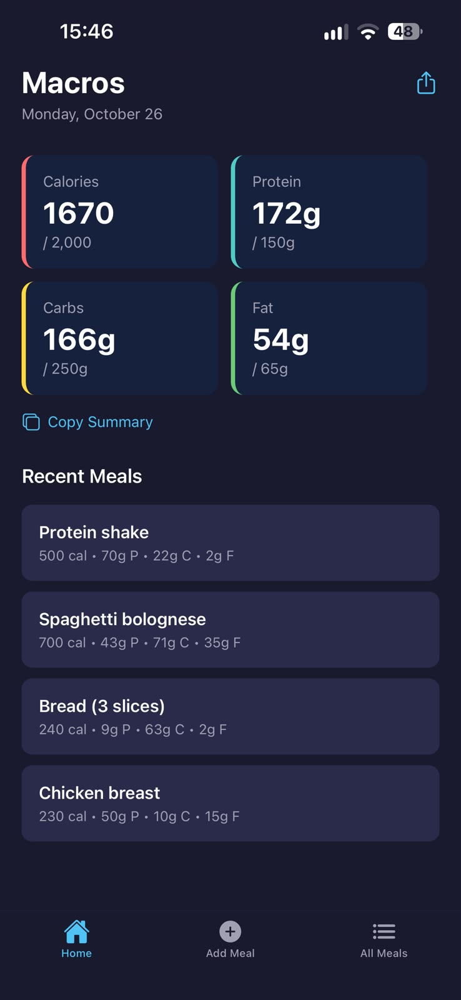
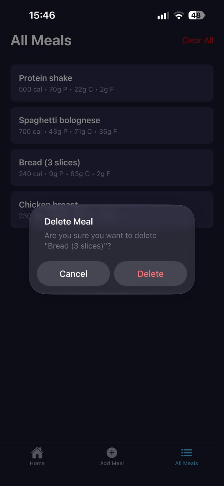
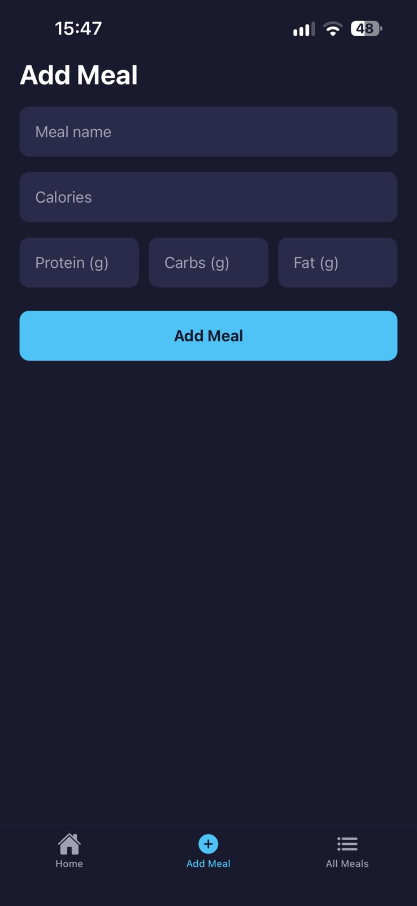
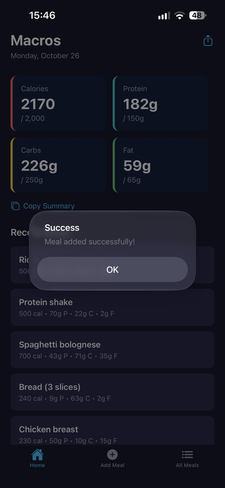

Macros: Calorie & Macro Tracker

A simple mobile app for logging meals and tracking calories, protein, carbs and fat in one place. Built with React Native, TypeScript and Expo.

Screenshots

  
  
  
  

Features
Log meals: add a meal with its name, calories, protein, carbs and fat
Macro overview: the home screen shows your calorie and macro totals at a glance
Recent meals: see your latest entries on the home screen
All meals: a full list of everything you've logged, with the option to delete a single meal or clear them all
Share and copy: share or copy your meal summary
Saved on your device: meals persist between sessions using local storage
Input feedback: validation for missing fields and haptic feedback when a meal is added
Tech Stack
React Native with Expo
TypeScript
Expo Router for file-based navigation between screens
AsyncStorage for on-device data persistence
Expo Haptics for tactile feedback
React Native Reanimated and Gesture Handler
Getting Started
Prerequisites
Node.js (LTS recommended)
The Expo Go app on your phone, or an Android emulator / iOS simulator
Installation
bash
git clone https://github.com/EmmanuelLombe/Macros_Calorie-tracker.git
cd Macros_Calorie-tracker
npm install
Run the app
bash
npx expo start

Scan the QR code with Expo Go, or press a (Android), i (iOS) or w (web) in the terminal.

Shortcuts:

bash
npm run android
npm run ios
npm run web

What I Learned
How the screens connect to each other and how navigation flows between them with Expo Router
How to structure a project: screens, reusable components, storage logic and shared styles each live in their own place
How to keep data in sync across screens by reloading it whenever a screen comes back into focus
How to handle user input properly: validating fields, converting text to numbers, and giving clear feedback with alerts and haptics   
